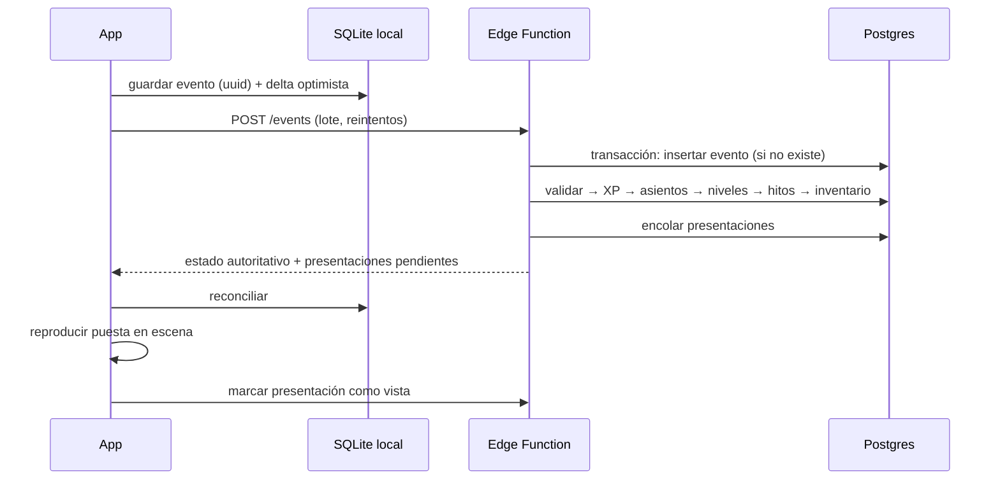

# KURA — Arquitectura v0.1

Sistema de recompensas, afirmaciones y dinámicas. App para iOS y Android.

> Estado: propuesta inicial. Los nombres dentro del universo (Resonancia, Ritmo, Destellos…) son provisionales.
> Pendiente: ajustar la sección de mundos/HUD cuando se revisen los prototipos de personajes.

---

## 1. Principios de diseño

1. **El contenido es datos, no código.** Prácticas, afirmaciones, recompensas, mundos y temporadas se definen en paquetes de contenido versionados. Una temporada nueva no debería requerir publicar una versión nueva en las tiendas.
2. **El servidor es la autoridad de la progresión.** El cliente muestra el resultado al instante (optimista), pero XP, niveles y desbloqueos los decide el servidor con las mismas reglas.
3. **Offline primero.** Una respiración o una afirmación deben poder completarse sin señal. Todo se guarda localmente y se sincroniza después sin duplicar recompensas.
4. **Nada se otorga dos veces, nada se pierde.** Cada evento lleva una llave de idempotencia; cada recompensa queda en un libro contable de solo-agregar.
5. **Respeta el ritmo.** La mecánica de constancia nunca castiga. No hay cajas de botín, ni rachas que se rompen a cero, ni notificaciones de culpa.
6. **Un motor, cinco pieles.** Todos los mundos usan el mismo motor de prácticas y el mismo HUD lógico; cada mundo aporta su tema visual, animaciones y sonido.

---

## 2. Stack recomendado

| Capa | Elección | Por qué |
|---|---|---|
| App | **React Native + Expo** (TypeScript, dev builds) | Un solo código para iOS/Android, actualizaciones OTA (EAS Update) para corregir sin pasar por revisión |
| Animación de personajes y HUD | **Rive** (máquinas de estado) + Reanimated + Skia | Personajes con estados (idle, celebrar, hablar), cambios de atuendo en runtime, archivos ligeros |
| Datos locales | **SQLite** (expo-sqlite + Drizzle) | Fuente de verdad local, cola de sincronización |
| Backend | **Supabase**: Postgres, Auth, Edge Functions, Storage | La progresión es relacional y transaccional; RLS protege datos privados (diario) |
| Widgets | Nativos: **WidgetKit** (Swift) y **Glance** (Kotlin), vía config plugins | No existe widget multiplataforma real; leen un feed precalculado por la app |
| Notificaciones | Locales programadas en el dispositivo + push (APNs/FCM) solo para temporadas/eventos | Las afirmaciones diarias funcionan sin servidor y en la zona horaria del usuario |
| Compras | RevenueCat | Suscripción y entitlements unificados en ambas tiendas |
| Calidad | Sentry, PostHog (analítica + feature flags), Maestro (E2E) | Ver sección 10 |

Alternativa válida: Flutter + Rive. Se recomienda RN/Expo por las OTA y por compartir el paquete de reglas (TypeScript) entre cliente y servidor.

### Estructura del repositorio (monorepo)

```
kura/
  apps/mobile/            App Expo (pantallas, mundos, HUD)
  packages/domain/        Motor de reglas puro: XP, niveles, hitos, ritmo (sin I/O)
  packages/content-schema/ Esquemas Zod de todo el contenido
  content/                Paquetes de contenido por temporada (JSON/YAML + i18n)
  supabase/               Migraciones SQL, políticas RLS, Edge Functions
  native/widgets/         WidgetKit (iOS) y Glance (Android)
```

`packages/domain` se ejecuta idéntico en la app (predicción optimista) y en la Edge Function (resultado autoritativo). Es la pieza con más pruebas del proyecto.

---

## 3. Modelo de dominio

```
Temporada ──< Guía ──1 Mundo (tema, HUD, ambientaciones)
               │
               ├──< Práctica ──< Paso
               ├──< Afirmación
               ├──1 Senda (track de niveles) ──< Nivel ──< Recompensa
               └──< Hito ──< Recompensa

Usuario ──< EventoDePráctica ──< AsientoDeXP
        ──< Progreso por guía (proyección)
        ──< Inventario ──  Equipamiento por guía (atuendo, ambientación, decoración)
        ──1 Ritmo (constancia)
        ──< PlanDiario
        ──< Diario / Afirmaciones propias / Favoritos
```

Conceptos:

- **Guía**: Alaira, Amaya, Azara, Nova, Orion. Cada uno tiene mundo, senda y catálogo propios.
- **Práctica**: unidad jugable (una respiración, un ritual de afirmaciones, una reflexión). Es una secuencia de **pasos**.
- **Resonancia**: XP por guía. Sube el **nivel de vínculo** con ese guía y avanza su senda.
- **Aura**: lo que el usuario ve como su progreso global. No es una moneda aparte: se deriva de las resonancias (ver 5.3).
- **Hito**: logro con condición declarativa ("7 respiraciones con Alaira", "primera reflexión nocturna").
- **Recompensa**: atuendo, ambientación, decoración, paquete de afirmaciones, fragmento de historia, tema de widget, título.

---

## 4. Motor de prácticas (las dinámicas)

Toda dinámica se construye con un conjunto pequeño de **tipos de paso**. Agregar una dinámica nueva es escribir contenido, no código.

| Paso | Qué hace | Usado por |
|---|---|---|
| `narracion` | Texto/voz del guía con animación | Todos |
| `respiracion` | Marcapasos visual con patrón (ej. 4-7-8), háptica | Alaira, Amaya |
| `afirmacion` | Mostrar, repetir N veces, mantener presionado para "sellar" | Alaira, Azara, Nova |
| `polaridad` | Elegir estado actual → elegir desde dónde responder | Alaira |
| `escala` | Deslizador 1–5 (energía, tensión, confianza) | Amaya, check-ins |
| `eleccion` | Opción única/múltiple, puede ramificar | Todos |
| `escritura` | Entrada de diario, privada | Orion, Azara |
| `temporizador` | Cuenta atrás para ejercicio físico o silencio | Amaya, Nova |
| `compromiso` | Definir una microacción con fecha; genera seguimiento | Azara, Nova |
| `cita` | Cita + autor + pregunta de reflexión; coleccionable | Orion |

Ejemplo de práctica en contenido:

```json
{
  "id": "alaira.polaridad.basico",
  "guide": "alaira",
  "kind": "polaridad",
  "durationSec": 180,
  "xp": 20,
  "minLevel": 1,
  "tags": ["calma", "manana"],
  "steps": [
    { "type": "narracion", "textKey": "alaira.polaridad.intro" },
    { "type": "polaridad", "id": "estado" },
    { "type": "respiracion", "pattern": [4, 4, 6, 0], "cycles": 5 },
    { "type": "afirmacion", "pool": "alaira.polaridad", "count": 3, "seal": true }
  ]
}
```

### Dinámicas por guía

| Guía | Núcleo | Dinámicas de lanzamiento | Bucle propio |
|---|---|---|---|
| **Alaira** (anfitriona) | Calma, polaridad | Respiración guiada, ritual de afirmaciones, cambio de polaridad | Check-in de estado antes/después: el usuario ve cómo cambia |
| **Amaya** (curandera) | Cuerpo | Escaneo corporal, movimiento suave, check-in de descanso/energía | Mapa del cuerpo que registra qué zonas ha escuchado |
| **Azara** (estratega) | Ambición | Meta → estrategia → microacción, reencuadre de creencias, revisión semanal | Compromisos con seguimiento; cumplirlos da resonancia extra |
| **Nova** (presencia) | Imagen y expresión | Retos de presencia (voz, postura, mirada), práctica frente al espejo, reto social del día | Retos escalonados por dificultad, el usuario elige su nivel |
| **Orion** (filósofo) | Sabiduría | Cita del día + reflexión, pregunta nocturna, lectura breve | Códice: colección de citas y reflexiones propias |

Nota para las tiendas: el contenido de Amaya es bienestar, no consejo médico; debe llevar el aviso correspondiente.

### Plan diario

Cada día (corte a las 04:00 hora local) se genera un plan de 3–5 prácticas:

1. Una práctica ancla de Alaira (respiración o afirmación), corta.
2. Una o dos de los guías que el usuario eligió como foco en el onboarding.
3. Una de un guía poco visitado ("invitación"), para descubrir el universo.
4. Seguimiento de compromisos abiertos (Azara/Nova), si existen.

El generador es una función pura de `(perfil, historial reciente, catálogo, fecha)`, por lo que es determinista y se puede probar. Se calcula en el dispositivo para funcionar offline.

---

## 5. Sistema de progresión y recompensas

### 5.1 Flujo de una recompensa



Garantías:

- **Idempotencia**: el `id` del evento lo genera el cliente (UUID). Reenviar el mismo evento no hace nada. El libro de XP tiene llave única `(evento, motivo)`.
- **Atomicidad**: todo el otorgamiento ocurre en una sola transacción de Postgres.
- **Presentación exactamente una vez**: los desbloqueos se guardan en una cola `reward_presentations`. Si la app se cierra a media animación, la recompensa ya es del usuario y la celebración se muestra al volver.
- **Reconciliación**: si el servidor rechaza o ajusta un evento, el cliente reemplaza su estado optimista por el autoritativo, sin animaciones de "pérdida".

### 5.2 Reglas de resonancia (XP por guía)

- Cada práctica tiene XP base según duración y profundidad (10–40).
- **Primera del día** con cada guía: ×2.
- **Rendimientos decrecientes**: a partir de la 4.ª práctica del día con el mismo guía, 25 % del XP. Evita el farmeo y protege el sentido de la app.
- **Plan completo**: bonificación fija repartida entre los guías del plan.
- **Compromiso cumplido** (Azara/Nova): bonificación al confirmarlo.
- Validación del servidor: la práctica existe y está desbloqueada, la duración es plausible (≥ 50 % de la mínima), tope diario de eventos, fecha local coherente con la zona horaria del perfil (tolerancia ±1 día).

### 5.3 Aura

El aura es la firma visual del usuario, no un número más:

- **Nivel de aura** = suma de niveles de vínculo de todos los guías.
- **Composición**: cada guía aporta un color; el aura mezcla los colores según la resonancia de los últimos 30 días. Quien practica mucho con Nova y Orion tiene un aura distinta a quien vive con Amaya.
- **Intensidad**: depende del ritmo de la semana actual (ver 5.5).

Esto convierte "conoce tu aura" en algo literal: la app le muestra al usuario en qué se está enfocando.

### 5.4 Sendas, hitos y recompensas

- **Senda del guía**: track lineal de niveles, permanente. Cada nivel entrega algo definido de antemano (el usuario ve lo que viene). Niveles clave entregan atuendos y ambientaciones; los intermedios, afirmaciones, fragmentos de historia y decoración.
- **Senda de temporada**: track temporal compartido por todos los guías; entrega los cosméticos y capítulos de historia de la temporada.
- **Hitos**: reglas declarativas evaluadas en el servidor tras cada evento:

```json
{
  "id": "alaira.respira7",
  "trigger": "practice_completed",
  "when": { "guide": "alaira", "kind": "respiracion", "countAtLeast": 7 },
  "grants": [{ "item": "alaira.ambience.amanecer" }, { "xp": 50, "guide": "alaira" }]
}
```

- **Sin azar**: toda recompensa es determinista. Sin cajas de botín (evita problemas regulatorios y es coherente con el producto).
- **Moneda blanda (Destellos)**: opcional y fuera del MVP. Solo se justifica si habrá tienda de cosméticos; si se agrega, usa el mismo libro contable.

Tipos de recompensa y su efecto:

| Tipo | Efecto |
|---|---|
| Atuendo | Cambia el artboard/skin del personaje en Rive |
| Ambientación | Cambia fondo, partículas, paleta y música del mundo |
| Decoración | Objetos colocables en ranuras fijas del espacio del guía |
| Paquete de afirmaciones | Añade afirmaciones al pool del usuario |
| Fragmento de historia | Desbloquea una entrada del códice/lore |
| Tema de widget | Estilo visual nuevo para el widget |
| Título | Texto visible en el perfil |

### 5.5 Ritmo (constancia sin castigo)

- El usuario elige su ritmo: 3, 5 o 7 días por semana.
- Un día cuenta con **una** práctica completada.
- Cumplir la semana suma una **semana en ritmo**. No cumplirla no borra nada: la intensidad del aura baja y vuelve a subir al retomar.
- **Pausa**: el usuario puede pausar (viaje, enfermedad) sin penalización.
- Las recompensas de constancia se basan en semanas acumuladas, no en días consecutivos.

---

## 6. Sistema de afirmaciones

**Catálogo.** Cada afirmación tiene: guía, texto por idioma, temas (confianza, calma, cuerpo, propósito…), polaridad de origen (para el ejercicio de Alaira), momento sugerido (mañana/tarde/noche), intensidad y temporada. Admite variables (`{nombre}`).

**Pool del usuario** = afirmaciones base + paquetes desbloqueados + afirmaciones propias escritas por el usuario + favoritas.

**Selección** (función pura, corre en el dispositivo):

1. Filtrar por momento del día y guías en foco.
2. Excluir las mostradas en los últimos N días.
3. Ponderar: favoritas y propias ×3, temas del foco ×2, estado declarado en el último check-in de polaridad.
4. Sorteo con semilla `(usuario, fecha, superficie)` para que app, widget y notificación coincidan.

**Superficies:**

| Superficie | Comportamiento |
|---|---|
| Ritual en la app | Paso `afirmacion`: leer, repetir, sellar. Da resonancia |
| Widget | Lee un feed de 7–14 días precalculado en almacenamiento compartido (App Group / DataStore). Tocar abre el ritual |
| Notificación | Local, programada dentro de las ventanas horarias que eligió el usuario. Máximo configurable por día; silencio automático si el usuario pausa |

El feed y las notificaciones se regeneran cada vez que la app se abre o cambia el pool.

---

## 7. Mundos y HUD

Cada mundo se describe con un **manifiesto de tema**; el código del HUD es único.

```json
{
  "guide": "nova",
  "palette": { "primary": "#…", "accent": "#…", "surface": "#…" },
  "typography": { "display": "…", "body": "…" },
  "hud": { "layout": "escenario", "progress": "anillo", "frame": "nova_frame.riv" },
  "character": { "file": "nova.riv", "stateMachine": "main", "outfits": ["base", "…"] },
  "ambiences": [{ "id": "base", "background": "…", "particles": "…", "music": "…" }],
  "transitions": { "enter": "nova_enter.riv", "reward": "nova_reward.riv" }
}
```

- **HUD lógico común**: nivel de vínculo, barra de resonancia, práctica del día, acceso a senda e inventario. El manifiesto decide disposición, marcos y animaciones.
- **Puestas en escena**: entrar al mundo, completar ritual, subir de nivel y desbloquear tienen cada una su animación por mundo, disparadas por la cola de presentaciones.
- **Personajes**: un archivo Rive por guía con máquina de estados (`idle`, `hablar`, `celebrar`, `guiar`) y atuendos intercambiables.
- **Rendimiento**: los recursos de cada mundo se descargan bajo demanda y se cachean; el mundo de Alaira va incluido en la instalación.

Esta sección se detallará con los prototipos de HUD de cada personaje.

---

## 8. Datos

### Contenido (solo lectura para el cliente, versionado)

`seasons`, `guides`, `worlds`, `practices`, `affirmations`, `reward_items`, `tracks`, `track_levels`, `milestones`, `content_versions`

### Estado del usuario

| Tabla | Propósito | Nota |
|---|---|---|
| `profiles` | Zona horaria, idioma, foco, ritmo, ventanas de notificación | |
| `practice_events` | Cada práctica completada | Solo-agregar; `id` = llave de idempotencia |
| `xp_ledger` | Asientos de resonancia | Solo-agregar; único `(event_id, reason)` |
| `guide_progress` | XP y nivel por guía | Proyección, reconstruible desde el libro |
| `inventory` | Recompensas obtenidas | Único `(user_id, item_id)` |
| `loadouts` | Atuendo, ambientación y decoración equipados por guía | |
| `milestone_progress` | Contadores y hitos completados | |
| `rhythm_state` | Semanas en ritmo, pausas | |
| `reward_presentations` | Cola de celebraciones pendientes | `seen_at` nulo = pendiente |
| `commitments` | Microacciones de Azara/Nova | |
| `journal_entries` | Reflexiones y check-ins | Privado, RLS estricta |
| `user_affirmations`, `favorites` | Pool personal | |

Todas las tablas de usuario llevan RLS `user_id = auth.uid()`. El cliente nunca escribe en `xp_ledger`, `guide_progress` ni `inventory`: solo las Edge Functions.

### Sincronización

- La app escribe primero en SQLite y agrega a una **bandeja de salida**.
- Envío por lotes con reintento exponencial; el orden se conserva por usuario.
- Cuentas **anónimas** desde el primer arranque (el usuario juega sin registrarse) y vinculación posterior a Apple/Google/correo sin perder progreso.
- Varios dispositivos: como el estado se deriva de eventos idempotentes, no hay conflictos de fusión en la progresión; el equipamiento usa "última escritura gana".

---

## 9. Temporadas y contenido

- Un paquete de contenido = manifiesto + JSON + traducciones + recursos, con número de versión y versión mínima de la app.
- La app consulta la versión al abrir, descarga diferencias y valida contra el esquema antes de activar. Si falla, conserva el paquete anterior.
- Una temporada puede añadir guías, prácticas, afirmaciones, una senda de temporada e historia. Los pasos de práctica nuevos (tipos que no existen en el motor) sí requieren versión nueva de la app; `minAppVersion` lo controla.
- Idiomas: español e inglés desde el inicio; todas las cadenas por clave.

---

## 10. Calidad: "sin errores"

| Riesgo | Defensa |
|---|---|
| Recompensa duplicada o perdida | Idempotencia + libro contable + transacción única; pruebas de propiedades sobre `packages/domain` (reenviar, reordenar y duplicar eventos produce el mismo estado) |
| Contenido roto en producción | Validación Zod en CI: referencias existentes, sendas sin huecos, toda recompensa alcanzable, todas las claves traducidas |
| Cambios de zona horaria / reloj manipulado | Fecha local calculada en cliente, validada en servidor; corte de día a las 04:00 |
| Regresiones de flujo | E2E con Maestro: onboarding, completar práctica offline, sincronizar, desbloquear, equipar |
| Fallos en dispositivos reales | Sentry con trazas; lanzamientos graduales; feature flags para apagar dinámicas |
| Corrección urgente | EAS Update (OTA) para JS y contenido |
| Economía mal calibrada | Simulador: perfiles de usuario sintéticos (casual, constante, intenso) recorren la senda para verificar tiempos de desbloqueo antes de publicar |

---

## 11. Fases

1. **Cimientos**: monorepo, esquema de contenido, `packages/domain` con pruebas, migraciones y Edge Function de eventos.
2. **Rebanada vertical — Alaira**: onboarding, mundo de Alaira completo, respiración + afirmaciones + polaridad, senda con recompensas, puesta en escena de desbloqueo, sincronización offline.
3. **Fuera de la app**: widget, notificaciones locales, ritmo.
4. **Resto de mundos**: Amaya, Azara, Nova, Orion sobre el mismo motor (cada uno es contenido + tema + sus pasos propios).
5. **Temporada 1**: senda de temporada, historia, compras.

La fase 2 valida toda la arquitectura con un solo personaje antes de multiplicar el trabajo de arte por cinco.

---

## 12. Decisiones abiertas

| Decisión | Recomendación |
|---|---|
| Stack | React Native + Expo + Rive + Supabase |
| Modelo de negocio | Gratis con Alaira completa; suscripción desbloquea los demás mundos y la senda de temporada. Sin anuncios |
| Moneda blanda y tienda | Fuera del MVP |
| Formato del arte de personajes | Rive si los personajes son 2D; si los prototipos son 3D hay que evaluar video/secuencias pre-renderizadas |
| Voz de los guías | Texto primero; audio grabado como mejora por temporada |
